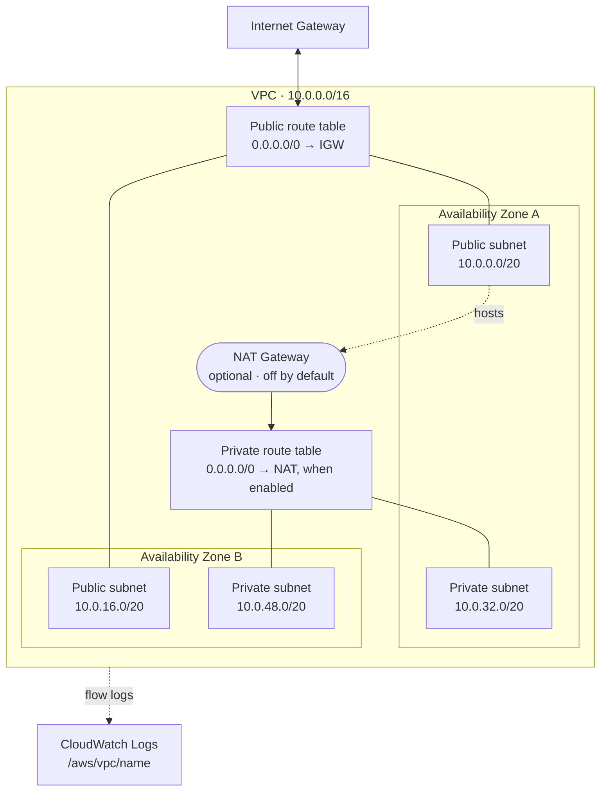

<div align="center">

# terraform-aws-vpc-baseline

**A production-shaped AWS network baseline in Terraform.**

Multi-AZ VPC · optional NAT · flow logs · least-privilege EC2 role over SSM, not SSH

[](https://github.com/Gautam-CyberSec/terraform-aws-vpc-baseline/actions/workflows/terraform.yml)
[](https://developer.hashicorp.com/terraform)
[](https://registry.terraform.io/providers/hashicorp/aws/latest)
[](.tflint.hcl)
[](LICENSE)

[Architecture](ARCHITECTURE.md) ·
[Lessons learned](LESSONS.md) ·
[Network module](modules/network) ·
[IAM module](modules/iam) ·
[Examples](examples) ·
[Remote state](docs/REMOTE-STATE.md)

</div>

---

I built this network by hand first — clicking through the VPC console, getting
route tables wrong, and learning the hard way that a private subnet without a NAT
gateway cannot reach the package mirror.

This is that network as code: reviewable, reproducible in a fresh account in about
ninety seconds, and destroyable in one command when the bill starts to matter.

```bash
git clone https://github.com/Gautam-CyberSec/terraform-aws-vpc-baseline.git
cd terraform-aws-vpc-baseline && terraform init && terraform plan
```

## What it builds



## Six decisions worth reading

| | Decision | Why |
|---|---|---|
| 1 | **NAT is off by default** | A NAT gateway bills from creation, not first use — roughly USD 40/month in `ap-south-1`. The accidental path should be the free one. |
| 2 | **Subnet indices are range-split, not interleaved** | Public takes slots `0..n-1`, private `n..2n-1`. Adding an AZ appends; interleaving would renumber and force Terraform to recreate every private subnet. |
| 3 | **The default security group is stripped** | Terraform cannot delete it, so this adopts it and removes every rule. Anything landing on it by accident gets no connectivity instead of a full mesh. |
| 4 | **Flow log IAM is scoped to one log group** | Published examples use `Resource: "*"`, granting write to every log group in the account. Scoping costs one line and closes a lateral path. |
| 5 | **SSM Session Manager, no SSH keys** | Port 22 stays closed. No bastion, no key distribution, every session in CloudTrail. |
| 6 | **`ListBucket` and `GetObject` are separate statements** | They act on different resource shapes. Merging them yields a policy that either fails to list or grants far more than intended. |

Full reasoning, including what was rejected and why, is in **[ARCHITECTURE.md](ARCHITECTURE.md)**.

## Usage

The two modules are independent. Take the network, the IAM role, or both.

```hcl
module "network" {
  source = "github.com/Gautam-CyberSec/terraform-aws-vpc-baseline//modules/network"

  name                    = "myapp-prod"
  cidr_block              = "10.20.0.0/16"
  availability_zone_count = 3

  enable_nat_gateway = true
  single_nat_gateway = false   # one per AZ: a zone failure keeps egress alive
}

module "iam" {
  source = "github.com/Gautam-CyberSec/terraform-aws-vpc-baseline//modules/iam"

  name                    = "myapp-prod"
  readable_s3_bucket_arns = ["arn:aws:s3:::myapp-assets"]
}
```

Full input and output tables are generated into each module's README:
**[modules/network](modules/network#inputs)** · **[modules/iam](modules/iam#inputs)**

The repository root is a runnable configuration wiring both together — start
there with [`examples/minimal`](examples/minimal) (two AZs, no NAT, near-zero
cost) or [`examples/complete`](examples/complete) (three AZs, NAT per AZ).

> **Cost.** With defaults the standing cost is essentially zero — VPCs, subnets,
> route tables and internet gateways are free. Enabling NAT is the expensive
> switch. Check [current pricing](https://aws.amazon.com/vpc/pricing/) and run
> `terraform destroy` when you are finished.

## Repository layout

```
├── main.tf · variables.tf · outputs.tf   root configuration
├── modules/
│   ├── network/     VPC, subnets, routing, NAT, flow logs
│   └── iam/         instance role, profile, scoped S3 policy
├── examples/
│   ├── minimal/     2 AZs, no NAT
│   └── complete/    3 AZs, NAT per AZ, 1-year retention
├── docs/REMOTE-STATE.md
└── .github/workflows/    fmt · validate · tflint · docs drift
```

## Development

```bash
make check     # everything CI runs
make docs      # regenerate module input/output tables
```

`make check` runs `terraform fmt`, `terraform validate` across the root and both
examples, `tflint` with the AWS ruleset, and a drift check confirming the
generated tables match the code. CI runs the same four on every push and uses no
AWS credentials — it is static analysis only and can never create a resource.

## Security

State files hold resource attributes in plain text and are gitignored; see
[docs/REMOTE-STATE.md](docs/REMOTE-STATE.md) for the encrypted S3 backend with
DynamoDB locking. The repository contains no credentials, account IDs, or real
resource names. Full control list and reporting process: [SECURITY.md](SECURITY.md).

## Roadmap

- [ ] VPC endpoints for S3 and DynamoDB, keeping that traffic off the NAT
- [ ] Optional IPv6 dual-stack
- [ ] Network ACLs as defence in depth behind security groups
- [ ] Terratest coverage for the subnet allocation logic

## Engineering decisions &amp; lessons learned

Four mistakes made while building this — including a documented security control
that accepted `arn:aws:s3:::*`, and a documentation drift check that failed on
the very commit that introduced it.

**[Read the retrospective →](LESSONS.md)**

## Contributing

Issues and pull requests welcome — see [CONTRIBUTING.md](CONTRIBUTING.md).
Run `make check` before opening one.

---

<div align="center">

**Gautam** · Cloud &amp; Backend Engineer

[Portfolio](https://Gautam-cloud.com) ·
[LinkedIn](https://linkedin.com/in/gautam-cybersec) ·
[gautamdem@gmail.com](mailto:gautamdem@gmail.com)

Licensed [MIT](LICENSE)

</div>
